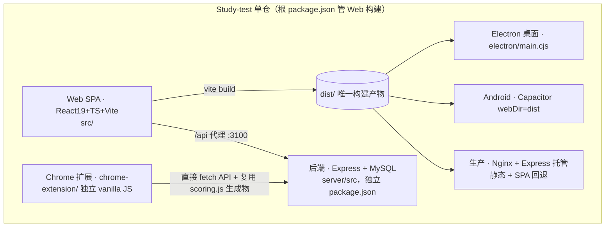

# Study-Test（全科题库）技术分析文档

> 交付物对应计划 `study-test-app-analysis`（原计划在根目录产出本文件与 `IMPLEMENTATION_PLAN.md`）。
> 事实基准：**2026-10-13**，全部结论取自当前仓库代码/迁移/配置实测，并对归档审计（`docs/archive/`，2025-07 ~ 2026-07）中的历史问题逐条复核「已解决 / 仍开放」。
> 定位：本文回答「系统现在是什么样、有哪些结构性问题」；改进任务的排期与优先级见配套的 [`IMPLEMENTATION_PLAN.md`](IMPLEMENTATION_PLAN.md)。
> 脱敏：本文不包含任何密钥/密码值；生产域名以 `<DOMAIN>`（现 `www.xiaoyue.shop`）指代，公网 IP 不落地。

---

## 一、项目定位

**Study-Test（全科题库）** 是一套面向「教师—学员」场景的**多科目在线题库与考试系统**，正演进为同时服务教育、企业内训、个人三类场景的学习与评估平台。

核心价值：

1. **题库 + 在线考试 + 错题本 + 学情/考情分析**的完整闭环；
2. **AI 自动出题 + 多格式文档导入（Word/PDF/Excel/MD/OCR/图片）** 降低建库成本；
3. **一套代码，四端覆盖**（Web / Electron 桌面 / Android(Capacitor) / Chrome 扩展），其中前三端复用同一 `dist/` 构建产物。

规模（实测）：前端 `src/` 约 70 源文件 + 约 10 测试文件；后端 `server/src` 17 个 `.js` 路由/工具（不含生成物）；数据库迁移 `server/migrations/001`–`024`。

---

## 二、技术栈

| 层 | 选型 | 版本 |
|---|---|---|
| 前端 | React + TypeScript + Vite | React 19 / TS 5.8 / Vite 6 |
| 样式 | Tailwind CSS（`@tailwindcss/vite`） | v4 |
| 路由 | react-router-dom（全站 `React.lazy` 路由级懒加载） | 7.x |
| 状态 | React Context + 自定义 Hooks（无 Redux/Zustand） | — |
| 后端 | Node.js + Express（ESM），无 ORM，裸 `mysql2/promise` | Express 4.21 |
| 数据库 | MySQL（连接池上限 10，utf8mb4，强制 `COLLATE=utf8mb4_unicode_ci`） | 5.7+（兼容性约束） |
| 认证 | JWT（`jsonwebtoken`）+ bcrypt | 默认有效期 7 天 |
| AI | Gemini / DeepSeek / 通义千问 / 智谱 / Moonshot / 百川 / OpenRouter / 自定义 | 多供应商路由 |
| 文档解析 | mammoth / pdfjs-dist / tesseract.js / xlsx / KaTeX | 全部函数内动态 `import()` |
| 日志 | pino + pino-http（4xx→warn / 5xx→error，探活不记） | 结构化 |
| 测试 | vitest 双门禁：root（约 96 例）+ server；`tsc --noEmit` lint 零错误 | — |
| 部署 | PM2 + Nginx + GitHub Actions（`deploy.yml`）；`migrate.js` 自动迁移 | — |
| 多端 | Electron（`nodeIntegration:false`+`contextIsolation:true`）/ Capacitor / Manifest V3 | — |

**选型评价**：现代主流栈，后端刻意轻量（Express + 原生 SQL），适合中小规模与快速迭代；React 19 / Tailwind v4 版本偏激进，需持续关注生态兼容。

---

## 三、系统架构

### 3.1 多端与构建产物（Mermaid）



- Web / Electron / Android **100% 复用同一 `dist/`**，是「纯前端 + 服务端」功能四端自动覆盖的原因。
- **唯一例外是 Chrome 扩展**：完全独立的 vanilla-JS 实现，自行 `fetch` 并重写登录/练习 UI；判分逻辑经 `npm run sync:scoring`（已挂 `prebuild`）从 SSOT 生成 `chrome-extension/scoring.js` 消除口径漂移，但业务代码仍是一份 fork（详见 §9 开放项）。

### 3.2 前端分层

SPA + 三视图状态机（练习：`welcome → exam → result`），正式考试为独立流程（`/formal-exam`、`/exams/manage`）。状态管理由 `src/context/AppContext.tsx` 的 `AppProvider` 组合 5 个 Hook 成单一 Context：

```
AppProvider
├── useAuth()          登录/注册/登出、JWT 生命周期、角色转换、绑定老师
├── useToast()         轻量通知
├── useUIState()       弹窗可见性、用户管理 UI、搜索/导出状态
├── useQuestionBank()  题目/科目/错题/收藏，挂载时从 API 拉取
└── useExam()          考试会话、计时、作答、评分、错题追踪
（另有 useFormalExam、useBackPrevention 两个页面级 Hook 不入 Context）
```

关键目录与职责：

- `services/api.ts` — 类型化 `ApiClient`，封装 `fetch`，自动附加 JWT、处理 401（清 token 并派发 `auth:expired`）；导出 `authApi/subjectApi/questionApi/practiceApi/syncApi/uploadApi/healthApi/inviteCodeApi/studentApi`。
- `services/api.mappers.ts` — **双轨类型映射层**：网络 DTO（snake_case）仅在 api 边界出现，消费方只见领域类型（camelCase），消除隐式假设。
- `services/examApi.ts` / `statsApi.ts` / `streakApi.ts` / `notificationApi.ts` / `tagApi.ts` / `exportApi.ts` — 按域拆分的 API 客户端。
- `services/geminiService.ts` — AI 出题核心，多供应商 + **三级 Key 降级**（用户 Key → 开发构建注入 → 服务端代理）。
- `services/extract/` — 导入解析器族（`csv/docx/md/pdf/xlsx/ocr/aiVision`），重型依赖全部**函数内动态 import**。
- `components/ImportModal.tsx` + `components/import/` — 导入入口壳 + 拆分子步骤（已从旧审计的 1710 行巨型文件拆分）。
- `components/ui/` — 统一底座组件（`Button/Spinner/EmptyState/VirtualList`）。
- `shared/scoring/` — **判分单一事实源（SSOT）**，框架无关纯函数 + vitest 用例，经 `prebuild` 同步到后端与扩展。

### 3.3 后端

Express + MySQL（ESM）。入口 `server/src/index.js`：加载 `.env` → CORS 白名单（由环境变量 `ALLOWED_ORIGINS` 驱动，不再硬编码域名）→ 挂载 `/api/*` → 生产托管 `dist/`（SPA 回退）→ 代理百度 OCR（`/api/ocr/baidu`，已加 `authMiddleware` + 限流 30 次/15 分钟/IP）。

路由（`server/src/routes/`，17 个文件）：

| 前缀 | 文件 | 职责 |
|---|---|---|
| `/api/auth` | `auth.js`（991 行） | 注册/登录/用户管理/改密/角色转换/绑定老师/服务端验证码/限流 |
| `/api/questions` | `questions.js` | 题目 CRUD + 可见性作用域（自有 + 订阅共享）+ 回收站/版本 |
| `/api/subjects` | `subjects.js` | 科目 CRUD + 三级共享（none/all/students）+ 订阅审批 + 学员白名单 |
| `/api/practice` | `practice.js` | 错题（连对 3 自动掌握）/收藏/学习统计 |
| `/api/exams` | `exams.js`（877 行） | 正式考试：试卷 CRUD/开考/交卷/成绩分析/超时 sweep（收卷委托 `examSweep.js`） |
| `/api/sync` | `sync.js` | 客户端 localStorage 数据上行迁移 + 全量导出（**已带 org 维度**） |
| `/api/invite-codes` | `invite-codes.js` | 邀请码（注册码/科目码）CRUD |
| `/api/students` | `students.js` | 教师侧学员审批/移除/重置密码 |
| `/api/ai` | `ai.js` | 服务端 Gemini 代理（内存限流 10 次/分，多实例失效 → 待 Phase 3 迁 Redis） |
| `/api/upload` | `upload.js` | 图片上传（MIME 双校验，已移除 SVG）；静态托管 `/api/uploads/` 需登录 |
| `/api/notifications` | `notifications.js` | 站内通知 + 未读角标（FR-701） |
| `/api/quota` | `quota.js` | 配额查询/拦截（FR-606） |
| `/api/stats` | `stats.js` | 学情/考情看板数据（读 `stats_daily` 预聚合） |
| `/api/streak` | `streak.js` | Streak 连续打卡 + 补签（FR-501） |
| `/api/tags` | `tags.js` | 知识点标签树（FR-108） |
| `/api/exports` | `exports.js` | 成绩/题库异步导出任务（FR-206） |
| `/api/admin` | `admin.js` | 平台管理端聚合 |

中间件 `middleware/auth.js`：`authMiddleware`（多数路由必需）+ `adminMiddleware`（admin+teacher）；`status ≠ active` 账号被 403 拦截（审核中）。

后台调度器（`server/src/utils/*Scheduler.js`，均以 MySQL `GET_LOCK()` 单例守卫 + 抖动 + 防重叠）：`examSweepScheduler`（收卷）、`statsAggregationScheduler`（`stats_daily` 预聚合）、`storageUsageScheduler`（用量告警）、`streakBreakScheduler`（断流归零）、`recycleCleanupScheduler`（回收站 30 天清理）、`exportJobScheduler`（导出）。

### 3.4 数据流

```
浏览器(React) ──fetch(JWT Bearer)──▶ ApiClient(api.ts) ──▶ Express 路由 ──▶ mysql2 连接池 ──▶ MySQL
     ▲                                      │                    │
     └──────── JSON（api.mappers 转领域类型）┘                    │
                                                判分统一委托 SSOT：examSweep.gradeAttempt → examScoring.generated.gradeQuestion
```

> **关键约定**：除 JWT Token 存 `localStorage` 外，业务数据不落地本地（无 IndexedDB 缓存）——保证多端一致，但强网络依赖、离线不可用（开放项 §9）。

---

## 四、数据模型

通过编号迁移 `server/migrations/001`–`024` 由 `migrate.js` 按序自动应用（状态记入 `schema_migrations`，幂等）。已远超旧审计所称「10 张表」，当前核心表约 20+：

| 表 | 关键字段 | 说明 |
|---|---|---|
| `users` | role ENUM(`admin/teacher/student/independent`)、status(`active/pending`)、teacher_id | 旧角色模型（Phase 2 将由 `org_members.role` 取代） |
| `organizations`（013） | id、type(`PERSONAL/...`)、name | **S0 shadow schema**：每个用户自动建 PERSONAL 影子租户 |
| `org_members`（013） | org_id、user_id、role | 成员关系 + 目标态角色权威（当前仅影子写入） |
| `subjects`（+014 org_id） | id(字符串主键)、share_scope、created_by、org_id | 科目 |
| `questions`（+014 org_id） | type、options(JSON)、answer(JSON)、subject_id、created_by、org_id | 题目；type 已扩 `judge/fill_in/short_answer` |
| `question_tags`（019） | org_id、name、parent_id | 知识点标签树（FR-108） |
| `question_recycle`/`question_versions`（017） | deleted_at、payload | 软删 + 版本历史（FR-107） |
| `exams`（010） | question_set(JSON)、duration_minutes、start/end_time、pass_score、status | 试卷定义 |
| `exam_attempts`（015） | exam_id+user_id(非唯一，取最高分)、status ENUM、answers/details(JSON)、deadline、**shuffle_seed/option_order** | 答卷；乱序 FR-202 |
| `mistake_records`/`favorites`/`study_stats`（+014 org_id） | — | 错题/收藏/学习统计 |
| `stats_daily`（023） | org_id、user_id、date、metric、value | 看板预聚合（FR-301/302） |
| `notifications`（020） | org_id、user_id、type、payload、read_at | 站内通知（FR-701） |
| `plans`/`quotas`（022） | plan_code、resource_type、limit、org_id | 配额框架（FR-606，`limit=-1` 仅付费档） |
| `storage_usage`（021） | org_id、bytes_used、file_count | 存储用量与告警（FR-109 地基，未迁 OSS） |
| `export_jobs`（018） | org_id、status | 异步导出 |
| `streaks`（024） | user_id、current、longest、last_active_date、makeup_cards | 连续打卡（FR-501） |
| `invite_codes`/`subject_subscriptions`/`subject_student_access` | — | 邀请码与订阅授权 |
| `email_verifications`（011） | sha256、TTL、限频、尝试计数 | 服务端验证码 |
| `visit_counter` | 单行 | 访问计数 |

**迁移机制**：已由旧审计的「手工按序执行、无框架」升级为 `migrate.js` 自动运行器 + `schema_migrations` 幂等 + CI 接入（旧 P0 已解决）。⚠️ 建表必须显式 `COLLATE=utf8mb4_unicode_ci`（连接层可能为 gbk/0900_ai_ci，否则外键报 incompatible）。**S0 编码约定：新表必带 `org_id`，写入即赋值、查询暂不过滤**（为 Phase 2 权威切换铺路）。

存储现状：上传文件仍**磁盘直存** `server/uploads/user_<id>/`（实测约 695 文件 / 15.2 MB / 全 .png / 无超 5MB），Nginx 静态映射带 nosniff/CSP。OSS 迁移属 Phase 3。

---

## 五、权限模型与用户关系（现状）

### 5.1 角色（现状四值，目标三层）

- 现状：`admin`（全权）/ `teacher`（建科目、管学员、共享）/ `student`（绑定老师，见教师共享）/ `independent`（自管、无老师绑定）。判定散落在 `exams.js#isOwner()`、`access.js`、`subjects.js`、`students.js`，均读 `users.role`。
- 目标（PRD v0.3 §2.1）：`platform_admin / org_admin / space_admin / content_author / examinee / reader` 三层，**角色权威切换至 `org_members.role`**（Phase 2）。
- 兼容映射：`admin→platform_admin`、`teacher→content_author`、`student/independent→examinee`；`users.role` 过渡期（6 个月）只读不回写。

### 5.2 用户关系与共享

- **租户抽象**：一切「可拥有题库/考试/成员关系」的单位统一为 `Organization`；独立用户落入系统自动创建的 PERSONAL 影子租户（013 已建，`personalOrg.js` 写入）。
- **三级科目共享**：`share_scope = none`（私有）/ `students`（创建者学员可见，可选白名单）/ `all`（任意用户凭邀请码订阅，自动批准）。
- **订阅可见性**：`subject_subscriptions`（申请/审批）+ `subject_student_access`（白名单），题目可见范围 = 自有 + 系统 + 已订阅。
- **Phase 2 待映射的四条关系**（不止 `teacher_id`）：`users.teacher_id`、`subject_subscriptions`、`subject_student_access`、`invite_codes.scope='students'`（现依赖 `teacher_id` 比对）。

### 5.3 数据隔离现状

当前**尚无查询层强制租户过滤**（org_id 只写不滤），隔离靠 `created_by`/订阅关系。跨租户越权自动化测试集尚未进 CI —— 这是 Phase 2 的核心待办（见 §9 与独立立项文档）。

---

## 六、核心业务逻辑

### 6.1 判分（SSOT，单轨已收敛）

- 单一事实源 `src/shared/scoring/index.ts`：`isAnswerCorrect / gradeQuestion / scoreByIndices / formatTime`，框架无关纯函数。
- **FR-110 已落地**：手写副本 `server/src/utils/examScoring.js` **已删除**，`exams.js` 经 `examSweep.gradeAttempt` 统一调用 SSOT 生成物 `examScoring.generated.js`（旧审计/开发文档 §12 所称「双轨并存」已消除）。
- 跨端同步：`npm run sync:scoring`（挂 `prebuild`）从 SSOT 生成后端 `examScoring.generated.js` 与扩展 `scoring.js`。⚠️ 约束：**改判分只改 SSOT，然后跑同步**，否则前后端/扩展产物漂移。
- 题型口径：`single`（字母↔文本双向匹配）；`multiple`（排序比较）；`judge`（正确/错误）；`fill_in`（逐空给分 + 归一化）；`short_answer`（人工判分）；`programming`（练习即时反馈用字符串归一相等，**正式考试不自动判分** `needs_manual=true` 留人工）。

### 6.2 考试全链路（收卷与超时）

- 服务端权威评分：`POST /exams/:id/submit` → `gradeAttempt`（逐题 `gradeQuestion`）；deadline = started_at + duration（服务端计时基准）。
- **FR-204 已落地**：旧「惰性 sweep 内嵌 7 个读入口、全卷范围 `(examId,null)` 造成单请求 N 次事务写风暴」已重构 —— 读路径移除内嵌全卷 sweep，`getAttempt` 改定向 `sweepSingleAttempt`，写路径与学员读路径保留有界即时收卷；新增 `examSweepScheduler`（`setInterval` tick 60s + `GET_LOCK` 单例 + 抖动 + 防重叠，分页 batchSize50/maxRows200 + 批间 `setImmediate` + 候选 >100 告警）。迁移 012 `ADD INDEX idx_sweep(status,deadline)`。

### 6.3 AI 出题与导入

- 多供应商路由 + 三级 Key 降级；生产构建 `vite.config.ts` 的 `define` 将所有 `*_API_KEY` 置空，前端不泄露密钥；服务端代理仅 Gemini（`ai.js`）。
- 导入支持 `.pdf/.docx/.doc/.txt/.md/.csv/.xlsx/.xls/.json`；Excel/CSV/JSON 结构化解析，其余文本抽取 + AI/规则解析；OCR 四链路（离线 tesseract / 在线百度 / Gemini 视觉 / PaddleOCR）；公式（KaTeX）已上线。
- **D4 已定案（场景区分收口）**：组织租户 AI 强制走服务端代理 + `checkQuota`；个人租户保留 BYO 直连（免责 + UI 明示 + 启用校验登记），`checkQuota` 覆盖组织租户路径。

---

## 七、部署与运维

- **CI（`deploy.yml`）**：`npm ci`（根+server）→ server vitest → root vitest → `tsc --noEmit` lint → build → rsync `dist/src/migrations`（dist/src 带 `--delete`）→ Secrets 写 `server/.env`（chmod 600）→ `npm ci --production` → `node src/migrate.js` → `pm2 reload` → nginx conf 原子更新（`nginx -t` 失败回滚）→ `/api/health` 探活。push main 触发自动部署。
- **进程**：线上单 `study-server`（PM2 fork 单实例）；根 `ecosystem.config.cjs` 为可移植双-app（前端 :5173 + 后端 :3100）。日志 pm2-logrotate。
- **容量硬约束（PRD 附录 A8）**：单机 PM2 单实例（CPU 密集判分与 API 抢核）、EmailJS 免费额度约 200 封/月、磁盘直存无 CDN、单 MySQL 与业务同机（`exam_attempts` 单行 JSON 并发 UPDATE 为交卷尖峰瓶颈）、CI 全量 rsync 非镜像化。

---

## 八、亮点（应保留）

1. `types.ts` 领域类型清晰；`api.mappers.ts` 双轨类型显式映射层。
2. 判分 SSOT + 单轨收敛 + `prebuild` 同步 + 一致性测试防漂移。
3. AI 三级 Key 隔离（生产 `define` 剥离 + 服务端代理限流）。
4. 安全基线到位：验证码服务端化（CSPRNG + sha256 + TTL + 防爆破 + 一次性）、上传 MIME 双校验 + nosniff/CSP、生产依赖 critical/high 归零（xlsx 书面豁免）、pino 结构化日志、Electron 安全配置。
5. 后台调度统一 `GET_LOCK` 单例约束，符合「所有周期任务必须带锁」硬约束。
6. 多端复用同一 `dist/` 的架构策略正确；CI 双门禁 + lint 零错误。

---

## 九、问题清单（P0–P3，逐条标注现状）

> 对归档审计（`CODE_AUDIT_REPORT` / `architecture-audit` / `module-consistency-audit` / `项目分析报告`）的历史问题按当前代码复核。**✅ 已解决** 项不再要求动作，仅留痕；**⏳ 开放** 项进入 `IMPLEMENTATION_PLAN.md` 排期。

### 9.1 历史问题复核结果（已解决）

| 旧编号 | 问题 | 现状 |
|---|---|---|
| A1 | 硬编码 PaddleOCR 密钥（前端明文） | ✅ 已移除（全仓 0 命中，改 localStorage 用户 token + env 可选） |
| A2 | 未开 TS strict（~95 处 any 根因） | ✅ `tsconfig` 已 `strict:true`+`noImplicitAny`，lint 零错误门禁 |
| B1/B2/B3 | 零代码分割 + 静态引入重型库 + 1.7MB 主包 | ✅ 全站 `React.lazy`，mammoth/pdfjs/xlsx/tesseract 函数内动态 import |
| B4 | core-js/regenerator 全量 polyfill | ✅ 已清理 |
| B5 | 后端 OCR `/api/ocr/baidu` 未鉴权 | ✅ 已加 `authMiddleware` + 限流 30/15min/IP |
| A5/P0-1 | 上帝文件（ImportModal 1710 / fileService 1189 等） | ✅ 大幅拆分（ImportModal→904 + `import/`；fileService→`extract/`；LoginModal 1205→622；`ui/` 底座） |
| P0-2/TD-2 | 判分逻辑 4 份 + 扩展 fork 口径漂移 | ✅ SSOT 单轨 + `sync:scoring` 生成扩展 `scoring.js`（判分口径统一，业务 UI 仍 fork 见下） |
| TD-6 | 文档背离（CONFIGURATION.md 讲 Python、CLAUDE.md 缺 exams） | ✅ 已重写文档体系（`docs/README.md` 索引 + 现行/SOP/归档三态） |
| TD-4/P0-2 | 迁移无框架、试错脚本绕开迁移 | ✅ `migrate.js` + `schema_migrations` + CI；一次性脚本归档 `scripts/` |
| TD-3 | 几乎零自动化测试 | ✅ root vitest ~96 例 + server 门禁 + `tsc --noEmit` |
| P0(§12) | 根目录 `.bak` 备份杂物 | ✅ 已物理删除（Glob 0 命中） |
| §4.3/R11 | 惰性 sweep 全卷写风暴 | ✅ FR-204 已重构（分页批处理 + 单例锁调度器） |

### 9.2 仍开放（P1）

- **[P1-1] Phase 2 角色权威未切换 + 跨租户隔离未进 CI**：`org_id`/`org_members` 仅影子写入，查询层未强制租户过滤；`isOwner()/access.js/subjects.js/students.js/sync.js` 仍读 `users.role`/`created_by`；无跨租户越权自动化测试集。**风险最高、越晚改越贵**，单独立项评估（见 `docs/` Phase 2 立项文档）。
- **[P1-2] `ai.js` 内存限流多实例失效**：手搓 `rateLimitMap`（`Map` + TTL，无容量上限），单机无状态前提下暂可接受；随 Phase 3 迁 Redis / 共享存储。
- **[P1-3] 前端强网络依赖**：除 JWT 外无本地缓存（无 IndexedDB），弱网/离线体验差。可评估题库本地缓存（属体验增强，非阻塞）。
- **[P1-4] Chrome 扩展仍是业务 fork**：判分口径已统一，但登录/练习 UI 独立实现，`manifest.json` host_permissions 写死生产域名，本地/测试联调需手改。长期可改为「加载主应用 Web」（对齐 Electron/Capacitor）。

### 9.3 仍开放（P2）

- **[P2-1] 前端 UI 一致性未完全收敛**（`module-consistency-audit`）：`ui/` 底座已建（Button/Spinner/EmptyState/VirtualList），但「统一 Modal 底座 P-1、危险操作统一走 AppConfirm P-2、返回/离开考试场景化 P-3、错误反馈 red/rose 混用 P-6」等仍有残留（部分弹窗仍手写 overlay、个别原生 `confirm/alert` 待清）。建议随功能迭代逐步收敛，非专项。
- **[P2-2] AppContext 单例巨型 Context**：任一子状态变更触发全量消费者重渲染；`useExam` 仍接收兄弟 hook 的 setter。可按域拆细粒度 Context / selector 订阅（性能与可测性优化）。
- **[P2-3] `exam_attempts` 单行 JSON 交卷热点**：1000 人同分钟交卷为单行 UPDATE 尖峰，队列化属 Phase 3。
- **[P2-4] 连接池偏小（10）/ 激进版本（React19/Tailwind v4）**：随规模与生态稳定度关注。
- **[P2-5] 题型深度判分**：`judge/fill_in/short_answer` 已进类型与判分单轨，但材料题（FR-104 `question_groups` 子题聚合判分）、听力题（FR-105）尚未落地（Phase 2/3）。

### 9.4 仍开放（P3，长期/差异化）

- **[P3-1] 编程题在线判题沙箱**（FR-106）：现为字符串匹配 / 人工判分，未做代码执行。前置：`src/pythonLevel4.ts` 为全仓零引用孤儿模块，沙箱上线前须先接入题库内容。
- **[P3-2] 商业化**（收费套餐/支付/开放 API/分享落地页，Phase 4）：配额框架（`plans/quotas/checkQuota`）已就位可承接，但订单/支付流水/发票/退款需新建表。
- **[P3-3] AI 教练进阶**（变式 FR-402 / 对话辅导 FR-403 / 学习计划 FR-404）：错题 AI 讲评（FR-401）为 M，其余 Could。

---

## 十、结论

系统在 2026-10 完成 P0–P2 安全/质量整改后，**已跨过「个人项目 → 规范产品」的工程化门槛**：strict 类型、CI 双门禁、迁移自动化、判分单轨 SSOT、后台任务单例锁、密钥隔离、结构化日志均已就位。旧审计的 P0 与多数 P1 结构性债务**已闭环**。

真正的剩余工作集中在两类：

1. **架构演进主线**：Phase 0/1 已实质完成（数据面补课 + 技术债前置 + 分析/触达闭环）；**Phase 2 多租户与角色权威切换是风险最高、越晚改越贵的一块**，需单独立项；Phase 3（高负载：Redis/队列/OSS）按性能阈值触发；Phase 4（沙箱/AI/商业）为长周期差异化。
2. **残留在产债**（P1-2~P2-5）：多为「随规模增长才放大」或「随功能迭代顺手收敛」的类型，不构成当前可用性阻塞。

配套排期见 [`IMPLEMENTATION_PLAN.md`](IMPLEMENTATION_PLAN.md)。
