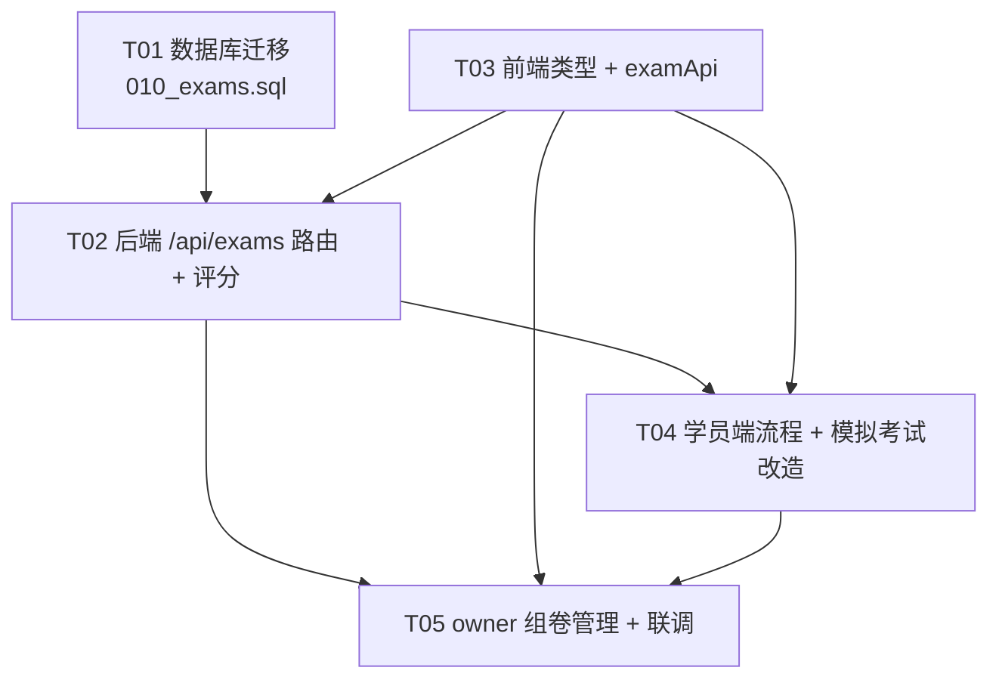

# 正式考试模块 + 模拟考试改造 — 技术方案与任务分解

> 作者：高见远（软件架构师）  |  基于现有 Study-Test 代码现状设计  |  复用现有 React19+TS+Vite+Tailwind 前端栈 与 Express+MySQL(ESM) 后端栈

---

## 实现校准（2026-10-11 对照代码核实）

> 本节为文档对齐任务的增量记录，设计原文保留不动。对照 `server/src/routes/exams.js`、`server/migrations/010_exams.sql`、`server/src/utils/access.js`、前端路由实现逐项核实。

**与设计一致（已核实落地）**：`exams`/`exam_attempts` 两表结构与 §3 DDL 一致（含非唯一索引、deadline）；§4 全部 13 个端点逐一存在（含 `/available`、`/my-history`、`/:id/sweep`）；`start` 复用未超时 in_progress attempt、时间窗校验统一走 SQL `NOW()`；`sweepExpiredAttempts` 惰性兜底；编程题 `is_correct=null, needs_manual=true`；`access.js` 已抽取 `canAccessSubject`/`canManageSubject`；`my-history` 聚合 bestScores、分析按每人最高分口径。

**实现后的架构演进（与本文档原设计不同之处）**：
1. **评分不再手工双份维护**：§1.2/§6.2 原计划「前端 TS 与后端 JS 两份实现保持一致」，现已重构为单一事实源 `src/shared/scoring/index.ts`，`npm run sync:scoring`（挂 `prebuild`，esbuild）自动生成 `server/src/utils/examScoring.generated.js` 与 `chrome-extension/scoring.js`；`src/utils/examScoring.ts` 仅剩兼容壳 re-export。
2. ⚠️ **未竟的技术债**：`server/src/routes/exams.js` 实际 import 的是手写副本 `server/src/utils/examScoring.js`，生成版暂无路由引用；修改判分规则时需手工同步两份，直至切换到 generated 产物（已在开发文档 §12 列为 P1 技术债）。
3. 前端 5 条路由后续均改为 `React.lazy` 路由级懒加载（本文档 §2.2 未提及，不冲突）。

---

## 一、实现方案与框架选型

### 1.1 需求拆解
| 模块 | 是否服务端持久化 | 关键能力 |
|------|----------------|---------|
| 模拟考试改造 | **否**（沿用 practiceApi 错题逻辑） | 把 `startExam('normal')` 的"随机抽题练习"改名为「模拟考试」；保留 random/full/mistakes/favorites；可选增强"交卷看解析/限时" |
| 正式考试模块 | **是**（新增表 + 路由） | owner 组卷/设分/限时/时间窗/状态机；学员窗口内参试、限时答题、到点或手动交卷、服务端自动评分；学员查看本次错题+历史成绩；owner 考试分析 |

### 1.2 框架与库选型（无新增重依赖）
- **前端**：完全复用现有栈。路由复用 `react-router-dom`（已安装，`src/App.tsx`）；状态复用 `AppProvider` 合并 Hook 的模式；UI 复用 `AppLayout` 与 `lucide-react` 图标。新增一个 `useFormalExam` Hook 与少量展示组件，**不引入新 npm 依赖**。
- **后端**：复用 `express` Router、`mysql2` 连接池（`pool.execute` 参数化）、`authMiddleware`（注入 `req.user`）。评分复用现有 `src/utils/examScoring.ts` 的 `isAnswerCorrect` 逻辑——**将同一纯函数移植为 `server/src/utils/examScoring.js`**（Node 端评分，避免信任客户端分数）。**不引入新 npm 依赖**。
- **存储**：`exams` 与 `exam_attempts` 两张新表，走既有迁移机制 `server/migrations/010_exams.sql`，由 `server/src/migrate.js` 按序幂等应用。

### 1.3 架构要点
- **固定题集用 JSON 列存放，而非独立关联表**。理由：① 避免 `exam_questions` 多表 join；② 题目内容仍保留在 `questions` 表作为唯一真相源，组卷只是引用 `question_id + points`；③ 评分时后端按 `question_id` 实时从 `questions` 取 `answer/options/type`，天然复用 `examScoring`。代价：题目被删除（科目级联删除）会使试卷缺题——在 start 时过滤缺失题并告警（详见"待明确事项"）。
- **评分权威在服务端**：学员"开始"接口返回的试卷**剥离 answer/explanation**（防作弊）；"提交"时后端用 `questions` 表原答案逐题评分，绝不信任前端传来的分数。
- **允许多次参考、取最高分**：`exam_attempts` **移除**唯一约束，同一学员对同一考试可有多条 attempt（`KEY idx_exam` / `KEY idx_user` 普通索引）。`start` 复用「未提交且未超时」的 attempt，否则新建；历史/分析以「每学生最高分 attempt」为口径（详见第四节与"待明确事项"已确认项）。

---

## 二、文件列表（相对路径）

### 2.1 后端（新增）
| 文件 | 说明 |
|------|------|
| `server/migrations/010_exams.sql` | 新增 `exams`、`exam_attempts` 两张表（utf8mb4，幂等） |
| `server/src/routes/exams.js` | `/api/exams` 全部端点（见第四节） |
| `server/src/utils/examScoring.js` | `isAnswerCorrect(q, userAns)` Node 版（移植自前端） |
| `server/src/utils/access.js` | 抽取 `canAccessSubject(userId, subjectId)` 与 `canManageSubject(userId, subjectId)` 共享判定（重构自 `practice.js` 的题目可见性 SQL，避免重复） |
| `server/src/index.js` | 挂载 `app.use('/api/exams', examsRoutes)`（改动约 3 行） |

### 2.2 前端（新增 / 改动）
| 文件 | 说明 |
|------|------|
| `src/services/examApi.ts` | **新增** `examApi` 对象，封装 `/api/exams` 全部调用（风格对齐 `src/services/api.ts`） |
| `src/types.ts` | **改动** 追加 `Exam` / `ExamAttempt` / `ExamAttemptDetail` / `ExamQuestionItem` / `ExamAnalysis` 等类型 |
| `src/hooks/useFormalExam.ts` | **新增** 正式考试状态机（list → taking → result）、客户端计时、调用 `examApi`、复用 `examScoring` 做本地预览 |
| `src/components/app/FormalExamScreen.tsx` | **新增** 答题界面（复用 `ExamScreen` 的题干/选项渲染模式，但去掉实时反馈、收藏、剔除等练习特性） |
| `src/components/app/FormalResultScreen.tsx` | **新增** 成绩 + 错题回顾（答错项 + 正确答案 + 解析） |
| `src/pages/FormalExamPage.tsx` | **新增** 路由 `/formal-exam`，承载学员"可参加列表/答题/结果" |
| `src/pages/ExamManagePage.tsx` | **新增** 路由 `/exams/manage`，owner 组卷/列表/编辑/分析 |
| `src/components/exam/ExamForm.tsx` | **新增** 创建/编辑考试表单（选题、设分、限时、时间窗、状态） |
| `src/components/app/WelcomeScreen.tsx` | **改动** 将 `startExam('normal')` 卡片「开始正式考试」改为「模拟考试（随机抽题）」文案（模拟考试改造） |
| `src/App.tsx` | **改动** 增加 `/formal-exam` 与 `/exams/manage` 两条路由 |

---

## 三、数据结构

### 3.1 `exams` 表（试卷定义）
```sql
CREATE TABLE IF NOT EXISTS exams (
  id              INT AUTO_INCREMENT PRIMARY KEY,
  subject_id      VARCHAR(50)  NOT NULL,                 -- 归属科目，决定可见学员范围
  title           VARCHAR(200) NOT NULL,
  description     TEXT,
  created_by      INT          NOT NULL,                 -- owner（subjects.created_by 或 admin/teacher）
  question_set    JSON         NOT NULL,                 -- 固定题集: [{"question_id":int,"points":int}, ...]
  total_points    INT          NOT NULL DEFAULT 100,     -- = SUM(points)
  duration_minutes INT         NOT NULL DEFAULT 60,      -- 限时（分钟）
  start_time      DATETIME     DEFAULT NULL,             -- 开放开始；NULL=发布即开放
  end_time        DATETIME     DEFAULT NULL,             -- 开放结束；NULL=长期
  pass_score      INT          NOT NULL DEFAULT 60,      -- 及格分（用于及格率）
  status          ENUM('draft','published','closed') NOT NULL DEFAULT 'draft',
  created_at      DATETIME     DEFAULT CURRENT_TIMESTAMP,
  updated_at      DATETIME     DEFAULT CURRENT_TIMESTAMP ON UPDATE CURRENT_TIMESTAMP,
  KEY idx_subject (subject_id),
  KEY idx_created_by (created_by),
  KEY idx_status (status),
  FOREIGN KEY (subject_id) REFERENCES subjects(id) ON DELETE CASCADE,
  FOREIGN KEY (created_by) REFERENCES users(id) ON DELETE CASCADE
) ENGINE=InnoDB DEFAULT CHARSET=utf8mb4;
```
- **`question_set` JSON 用途**：有序固定题集，每项 `{question_id, points}`。后端组卷/评分时按 `question_id` 关联 `questions` 表取题面与答案；`points` 为该题分值（取代现有 100/n 均分）。
- 为什么不拆 `exam_questions` 关联表：题面以 `questions` 表为唯一真相源，组卷仅引用，避免双写漂移；评分仅一次 join（`WHERE id IN (...)`）。

### 3.2 `exam_attempts` 表（学员答卷/作答记录）
```sql
CREATE TABLE IF NOT EXISTS exam_attempts (
  id            INT AUTO_INCREMENT PRIMARY KEY,
  exam_id       INT          NOT NULL,
  user_id       INT          NOT NULL,
  status        ENUM('in_progress','submitted','auto_submitted') NOT NULL DEFAULT 'in_progress',
  answers       JSON         DEFAULT NULL,               -- {"question_id": userAnswer}
  details       JSON         DEFAULT NULL,               -- 见下，错题回顾与分析的数据源
  score         INT          DEFAULT 0,                  -- 实际得分（SUM earned）
  correct_count INT          DEFAULT 0,
  total_count   INT          DEFAULT 0,
  started_at    DATETIME     DEFAULT CURRENT_TIMESTAMP,
  submitted_at  DATETIME     DEFAULT NULL,
  deadline      DATETIME     DEFAULT NULL,               -- started_at + duration_minutes（服务端计时基准）
  created_at    DATETIME     DEFAULT CURRENT_TIMESTAMP,
  updated_at    DATETIME     DEFAULT CURRENT_TIMESTAMP ON UPDATE CURRENT_TIMESTAMP,
  -- 已确认修订：移除 UNIQUE(exam_id,user_id)，允许同一学员多次参考、取最高分
  KEY idx_exam (exam_id),                                -- 非唯一索引
  KEY idx_user (user_id),                               -- 非唯一索引
  FOREIGN KEY (exam_id)  REFERENCES exams(id)  ON DELETE CASCADE,
  FOREIGN KEY (user_id)  REFERENCES users(id)  ON DELETE CASCADE
) ENGINE=InnoDB DEFAULT CHARSET=utf8mb4;
```
> **【已确认修订】多次参考取最高分**：移除 `UNIQUE KEY uk_exam_user (exam_id, user_id)`，仅保留 `KEY idx_exam (exam_id)` 与 `KEY idx_user (user_id)`（非唯一）。同一学员对同一考试可产生多条 attempt 记录。
- **`details` JSON 结构**（提交时由服务端计算并落库）：
```json
[
  {
    "question_id": 12,
    "user_answer": "B",
    "correct_answer": "B",
    "is_correct": true,
    "points": 20,
    "earned": 20,
    "explanation": "……",
    "needs_manual": false
  },
  {
    "question_id": 31,
    "user_answer": "print('hi')",
    "correct_answer": "print('hi')",
    "is_correct": null,
    "points": 20,
    "earned": 0,
    "explanation": "……",
    "needs_manual": true
  }
]
```
  - 用途：① 学员「查看某次考试错题」= 过滤 `is_correct=false` 的项（编程题 `is_correct=null` 也列入待定，透出 `correct_answer` + `explanation`）；② owner「每题错误率」= 按 `question_id` 聚合 `is_correct` 比例（编程题不计入自动判分口径）。落库而非实时计算，省去重复评分、且历史快照稳定。
  - **编程题不自动判分（已确认）**：`type='programming'` 时 `isAnswerCorrect` 返回 `is_correct=null`、`earned=0`，并在该项标记 `needs_manual=true`（待人工判分）。**口径：编程题分值保留计入 `total_points`（不剔除），但 `earned` 恒为 0；`score` = 自动判分题的 `earned` 之和；`pass_score`/及格率仍按 `total_points` 口径。** 后续若有人工判分回填，可单独更新该 attempt 的 `score` 并置 `needs_manual=false`。
- **`deadline`**：由 `started_at + duration_minutes` 得出，是"到点自动交卷"的权威基准（强制自动交卷策略见 4.2 与第五节）。

### 3.3 类关系（Mermaid，详见 `class-diagram.mermaid`）
`Exam` 1—* `ExamQuestionItem`（question_set）；`Exam` 1—* `ExamAttempt`；`User` 1—* `Exam`(created_by) / `ExamAttempt`(user_id)；`Subject` 1—* `Exam`(subject_id)；`ExamAttempt` 1—* `ExamAttemptDetail`（details）；`Question` 被 `ExamQuestionItem` 与 `ExamAttemptDetail` 引用（含答案快照）。

---

## 四、接口设计（`/api/exams`，由 `exams.js` 实现）

> 鉴权：除特别说明外均需 `authMiddleware`。`owner` = `req.user` 是 admin/teacher **或** `req.user.id === exams.created_by`（且 `exams.created_by` 一般是科目 owner）。

| 方法 & 路径 | 鉴权 | 说明 | 关键入参 | 关键出参 |
|------------|------|------|---------|---------|
| `POST /api/exams` | owner | 创建试卷（draft） | `subject_id, title, question_set:[{question_id,points}], duration_minutes, start_time?, end_time?, pass_score?, description?` | `{id, status:'draft'}` |
| `PUT /api/exams/:id` | owner | 更新试卷（仅 draft/closed 可改题集，published 仅改时间窗/状态） | 同上字段子集 | `{message}` |
| `DELETE /api/exams/:id` | owner | 删除试卷（级联删 attempts） | — | `{message}` |
| `GET /api/exams` | owner | 我的试卷列表（含 attempts 数、平均分简报） | — | `{exams:[Exam & summary]}` |
| `GET /api/exams/available` | 学员 | 可参加列表：published + 当前在窗口内 + 科目可访问（同一考试可多次参加，故不再用"未交卷"过滤） | — | `{exams:[{id,title,subject_id,duration_minutes,start_time,end_time,total_points,attempt_state}]}`（attempt_state: none/in_progress/submitted） |
| `GET /api/exams/:id` | owner | 试卷详情（解析题集为含答案的完整 `questions`，用于编辑/预览） | — | `{exam: Exam & {questions:[...]}}` |
| `POST /api/exams/:id/start` | 学员 | 开始作答：校验窗口/权限；**若该用户本场存在「未提交且未超时」attempt 则复用，否则新建** `in_progress` attempt，返回**剥离答案**的试卷 | — | `{attemptId, deadline, reused:bool, questions:[{id,type,title,options,code}(无 answer/explanation)], total_points}` |
| `POST /api/exams/:id/submit` | 学员 | 提交评分：服务端逐题评分落库（编程题 `is_correct=null,earned=0,needs_manual=true`，不参与自动计分） | `{attemptId, answers:{[qid]:ans}}` | `{score, total_points, correct_count, details:[...含 correct_answer+explanation]}` |
| `GET /api/exams/attempts/:attemptId` | 本人/owner | 查看某次答卷（**透出 correct_answer + explanation 给学生**，含编程题待定项） | — | `{attempt: ExamAttempt & {exam_title, questions}}` |
| `GET /api/exams/my-history` | 学员 | 我的历史成绩（跨考试，**返回全部 attempt 并为每场考试聚合 best_score**） | — | `{history:[{attemptId,exam_id,exam_title,score,total_points,pass_score,passed,submitted_at,is_best}], bestScores:{[exam_id]:number}}` |
| `GET /api/exams/:id/analysis` | owner | 考试分析（实时聚合，**口径=每学生最高分 attempt**：参考人数/平均分/及格率/每题错误率均基于每人最佳成绩） | — | `{analysis: ExamAnalysis}`（注明口径） |
| `GET /api/exams/:id/attempts` | owner | 本卷全部答卷列表（下钻，**同一学生可有多条**） | — | `{attempts:[...]}` |
| `POST /api/exams/:id/sweep` | owner | 批量强制自动交卷：对本题 `status='in_progress' 且 deadline 已过` 的 attempt 执行 auto_submit（亦供外部 cron 调用） | — | `{autoSubmitted:number}` |

### 4.1 复用现有能力
- **拉题**：组卷时前端用现有 `questionApi.list({subject})` 列出科目题目供 owner 勾选；"开始"接口后端用 `WHERE id IN (...)` 从 `questions` 取题。
- **评分**：服务端复用移植版 `examScoring.isAnswerCorrect`（与前端 `src/utils/examScoring.ts` 逻辑一致）。
- **时间窗/权限**：`canAccessSubject()` 复用 `practice.js` 既有可见性 SQL（created_by / 订阅 / share_scope=all或students + `subject_student_access` 白名单）。

### 4.2 关键校验（放后端，详见"共享约定"）

**强制自动交卷策略（已确认，三管齐下、无后台调度器）**
- **(a) 前端主动**：`useFormalExam` 倒计时归零 → 自动调用 `submit`（优先体验，正常网络下即交卷）。
- **(b) 后端惰性兜底**：任意 `/api/exams` 请求入口先调用 `sweepExpiredAttempts(scope)` —— 将 `status='in_progress' AND deadline < NOW()` 的 attempt 立即按"当前已填 answers"评分并置 `auto_submitted`（缺失题判错）。幂等：一旦 `status≠in_progress` 不再被选中。在 `start / listAvailable / submit / getAttempt / my-history / analysis / attempts` 入口统一前置。
- **(c) owner 手动/外部 cron**：新增 `POST /api/exams/:id/sweep`，owner 或定时任务可批量触发本场过期 attempt 的 auto_submit，返回 `autoSubmitted` 计数。

**各端点校验**
- `start`：① `status='published'`；② `start_time IS NULL OR NOW()>=start_time`；③ `end_time IS NULL OR NOW()<=end_time`；④ 科目可访问；⑤ **复用逻辑**：查本用户本场 `status='in_progress' AND deadline>NOW()` 的 attempt，有则复用（返回 `reused:true`），否则 `INSERT` 新 attempt。
- `submit`：① attempt 归属当前用户且 `status='in_progress'`；② `NOW()<=deadline` 正常提交，`>` 则置 `auto_submitted`；③ 以服务端 `questions` 答案为准评分；④ 编程题 `is_correct=null, earned=0, needs_manual=true`；⑤ 写入 `answers/details/score/correct_count/total_count/status`。
- `sweep`：仅 owner；对本题 `in_progress AND deadline<NOW()` 的 attempt 执行与 (b) 相同的评分落库。

---

## 五、程序调用流程（owner 出题 → 学员参试 → 提交评分 → 错题/历史/分析）

> 详细时序见 `sequence-diagram.mermaid`，以下为要点步骤。

**① owner 出题**
1. `ExamManagePage` 调 `examApi.create(payload)` → `POST /api/exams`，后端 `INSERT exams(question_set JSON)`，返回 `id`（draft）。
2. owner 在表单把 `status` 改为 `published`（或留 draft 稍后发布）→ `PUT /api/exams/:id`。

**② 学员参试**
3. `FormalExamPage` 调 `examApi.listAvailable()` → `GET /api/exams/available`，拿到可参加的试卷（同一考试可多次参加，`attempt_state` 反映当前进度）。
4. 点击开始 → `examApi.start(examId)` → `POST /api/exams/:id/start`：后端校验窗口/权限 → **复用本用户本场「未提交且未超时」的 attempt（reused:true）或新建** `in_progress` attempt（写 `deadline`）→ 取题并**剥离 answer/explanation** 返回。
5. 客户端 `useFormalExam` 启动计时器（基于 `deadline`），学员逐题作答。

**③ 提交评分 + 强制自动交卷**
6. 手动交卷，或倒计时归零由前端自动调用 `submit` → `examApi.submit(examId,{attemptId,answers})` → `POST /api/exams/:id/submit`（后端惰性兜底：入口先 `sweepExpiredAttempts` 处理任何已超时 attempt）。
7. 后端：校验 attempt/窗口 → 取 `questions`（含 answer）→ `examScoring.isAnswerCorrect` 逐题评分（编程题 `is_correct=null,earned=0,needs_manual=true`）→ 写 `answers/details/score/correct_count/total_count/status` → 返回 `details`（含 `correct_answer` + `explanation`）。
8. `FormalResultScreen` 展示成绩与错题回顾（透出正确答案+解析，含编程题待定项）。
9. **超时兜底**：若学员未在 `deadline` 前交卷，后续任意请求经 (b) 惰性 auto_submit，或 owner 调 `POST /api/exams/:id/sweep`（c）批量置 `auto_submitted` 并完成评分。

**④ 错题 / 历史 / 分析（多次参考取最高分口径）**
10. 学员「查看本次错题」→ `examApi.getAttempt(attemptId)` → 读 `details` 展示答错项（及编程题待定项）+ 正确答案 + 解析。
11. 学员「我的历史」→ `examApi.myHistory()` → `GET /api/exams/my-history` 返回**全部 attempt**，并为每场考试聚合 `bestScores`（历史页以最高分为准展示，`is_best` 标记最佳次）。
12. owner「考试分析」→ `examApi.analysis(examId)` → `GET /api/exams/:id/analysis` 实时聚合，**口径=每学生最高分 attempt**（参考人数按"有 attempt 的去重学生数"、平均分/及格率/每题错误率均基于每人最佳成绩计算）。

---

## 六、共享约定（跨文件）

1. **类型唯一来源**：`Exam` / `ExamAttempt` / `ExamAttemptDetail` / `ExamQuestionItem` / `ExamAnalysis` 全部定义在 `src/types.ts`，前后端共用同一字段语义（后端 JSON 列读取后 `JSON.parse` 即得对应结构）。
2. **评分统一走 `examScoring`**：前端 `src/utils/examScoring.ts` 与后端 `server/src/utils/examScoring.js` 为同一逻辑的 TS/JS 双份实现，判定规则必须保持一致（单选字母/文本、多选排序比对、编程归一化字符串匹配）。**服务端评分为权威**，前端仅用于本地预览。
3. **时间窗与权限校验放后端**：`start`/`submit` 的窗口与科目可见性由 `access.js` 的 `canAccessSubject`/`canManageSubject` 判定，前端不信任本地时间做放行。
4. **JSON 字段约定**：`exams.question_set` = `[{question_id:number, points:number}]`；`exam_attempts.answers` = `{[question_id:number]: string|string[]}`；`exam_attempts.details` = `ExamAttemptDetail[]`。后端 `SELECT` 后统一 `JSON.parse`（参照 `practice.js` 写法）。
5. **状态机**：`exams.status ∈ {draft,published,closed}`；`exam_attempts.status ∈ {in_progress,submitted,auto_submitted}`。published 后才可被学员 start。
6. **事务**：创建 attempt + 写入/更新统一用 `pool.getConnection()` + `beginTransaction/commit/rollback`（参照 `practice.js` 的 stats 写法）。
7. **错题联动（模拟考试）**：模拟考试改造沿用 `practiceApi` 错题逻辑，不新增持久化；正式考试的"错题回顾"直接读 `exam_attempts.details`，**不**写入 `mistake_records`。
8. **编程题不自动判分（已确认）**：`examScoring.js` 中 `type='programming'` 时 `isAnswerCorrect` 返回 `{is_correct:null, earned:0, needs_manual:true}`；客观题照常返回 `{is_correct:bool, earned:points}`。**评分口径**：`total_points` 保留含编程题分值（不剔除），`score = Σ(客观题 earned)`，`pass_score`/及格率仍按 `total_points` 口径；编程题人工判分回填时单独更新该 attempt 的 `score` 并置 `needs_manual=false`，分析口径同步以最新 `score` 计。
9. **脱敏边界（已确认）**：`available` 列表与 `start` 返回的试卷**不带 answer/explanation**；`submit` 返回、`getAttempt`、结果页**透出 correct_answer + explanation** 给学生（含编程题待定项）。所有答案仅在服务端评分时使用 `questions` 表原值。
10. **多次参考取最高分（已确认）**：`exam_attempts` 无唯一约束；`start` 复用进行中未超时 attempt；`my-history` 聚合 `bestScores`、`analysis` 以「每学生最高分 attempt」为口径。自动交卷策略见 4.2（前端主动 + 后端惰性兜底 + owner sweep 三管齐下）。

---

## 七、待明确事项（需用户 / PM 确认）

> 以下 1/3/5 已获用户确认（见各条标注）；其余仍为开放项。

1. ~~是否允许多次参考？~~ **【已确认】多次参考、取最高分**：`exam_attempts` 移除唯一约束，支持同一学员多条 attempt；`my-history` 聚合 `bestScores`、分析以「每学生最高分 attempt」为口径。
2. **答卷答案是否长期存储？** 设计默认落库 `answers/details`（支撑错题回顾与历史、含 `correct_answer` 快照）。若涉及合规/隐私需定期清理，请明确保留期（本期不实现清理）。
3. ~~分析实时计算还是落表？~~ **【已确认】实时聚合**，口径=每学生最高分 attempt；数据量小，不落 `exam_stats` 表。
4. **题目被删除/编辑时试卷怎么办？** `subjects→questions` 是 `ON DELETE CASCADE`，删除科目会丢题。设计在 `start` 时过滤缺失题并告警；是否应禁止删除"含已发布考试"的科目，请确认（建议禁止，待定）。
5. ~~正式考试是否要防切屏/防作弊？~~ **【已确认超时处理】强制自动交卷**：前端倒计时归零主动 submit + 后端请求入口惰性 auto_submit + owner `POST /:id/sweep` 三管齐下（详见 4.2）。更严格防作弊（切屏记录等）本期不纳入。
6. **模拟考试"限时/交卷看解析"是否本期实现？** 需求标注为"非必须"。若实现，仅在前端 `useExam` 增加一个可选 `timeLimit` 与"交卷后显示解析"开关，不影响后端。
7. **编程题人工判分流程（新增开放项）**：编程题 `is_correct=null, earned=0, needs_manual=true`，由谁判分（owner/teacher）、通过什么界面回填 `score`、回填后是否通知学员，本期仅定义数据标记（`needs_manual`）与口径，判分 UI 列为后续迭代——请确认是否纳入本期范围。

---

## 八、所需依赖（Packages）

**前端、后端均无新增 npm 依赖。**

| 包 | 版本 | 用途 | 状态 |
|----|------|------|------|
| `react` / `react-dom` | ^19 | UI（已装） | 复用 |
| `react-router-dom` | 已装 | `/formal-exam`、`/exams/manage` 路由 | 复用 |
| `tailwindcss` | v4 | 样式（已装） | 复用 |
| `lucide-react` | 已装 | 图标 | 复用 |
| `express` / `mysql2` / `jsonwebtoken` | 已装 | 后端路由/DB/鉴权 | 复用 |
| `examScoring.js`（新增文件，非依赖） | — | Node 端评分纯函数 | 移植自前端 |

> 说明：原 `examScoring.ts` 为纯函数、无第三方依赖，移植为 `.js` 零成本；后端评分不引入任何新库。

---

## 九、任务列表（按依赖有序，≤5 个）

### T01 — 数据库迁移（项目基础设施：表结构）
- **源文件**：`server/migrations/010_exams.sql`
- **依赖**：无
- **优先级**：P0
- **工作量**：0.5 人天
- **内容**：按第三节 DDL 建 `exams` 与 `exam_attempts` 两张表，utf8mb4、外键级联；**`exam_attempts` 仅 `KEY idx_exam` / `KEY idx_user`（非唯一，支持多次参考）**，不再有 `UNIQUE(exam_id,user_id)`；幂等（`IF NOT EXISTS`），由 `migrate.js` 自动按序应用。

### T02 — 后端 `/api/exams` 路由 + 评分工具
- **源文件**：`server/src/routes/exams.js`、`server/src/utils/examScoring.js`、`server/src/utils/access.js`、`server/src/index.js`（挂载路由）
- **依赖**：T01
- **优先级**：P0
- **工作量**：3.0 人天（+0.5）
- **内容**：实现第四节全部端点（含 `POST /:id/sweep`）；移植 `isAnswerCorrect` 到 `examScoring.js`，**编程题返回 `{is_correct:null, earned:0, needs_manual:true}`**；抽取 `canAccessSubject/canManageSubject`（重构自 `practice.js`）；`pool.execute` 参数化 + 事务；JSON `JSON.parse`；窗口/权限校验放后端；**`start` 复用/新建 attempt 逻辑 + `sweepExpiredAttempts` 惰性自动交卷（评分落库，缺失题判错）**；`my-history` 聚合 `bestScores`；`analysis` 以「每学生最高分 attempt」为口径。

### T03 — 前端类型与 API 服务
- **源文件**：`src/types.ts`（追加类型）、`src/services/examApi.ts`（新增）
- **依赖**：无（可与 T02 并行）
- **优先级**：P0
- **工作量**：0.5 人天
- **内容**：在 `types.ts` 追加 `Exam/ExamAttempt/ExamAttemptDetail/ExamQuestionItem/ExamAnalysis`（注意 `is_correct` 可空、`needs_manual` 字段）；新增 `examApi` 对象封装全部 `/api/exams` 调用（含 `sweep`），风格对齐 `src/services/api.ts`。

### T04 — 学员端正式考试流程 + 模拟考试改造
- **源文件**：`src/hooks/useFormalExam.ts`、`src/components/app/FormalExamScreen.tsx`、`src/components/app/FormalResultScreen.tsx`、`src/pages/FormalExamPage.tsx`、`src/components/app/WelcomeScreen.tsx`（改文案）、`src/App.tsx`（加 `/formal-exam` 路由）
- **依赖**：T02、T03
- **优先级**：P1
- **工作量**：2.5 人天
- **内容**：`useFormalExam` 状态机 + 客户端基于 `deadline` 计时，**倒计时归零自动 submit**（强制自动交卷前端侧）；处理 `start` 的 `reused` 复用；`FormalExamScreen` 答题；`FormalResultScreen` 成绩+错题回顾（透出 `correct_answer`+`explanation`，含编程题待定项）；`FormalExamPage`；`WelcomeScreen` 将 `startExam('normal')` 卡片「开始正式考试」改为「模拟考试（随机抽题）」；`App.tsx` 加路由。

### T05 — owner 组卷管理 + 联调收尾
- **源文件**：`src/pages/ExamManagePage.tsx`、`src/components/exam/ExamForm.tsx`、`src/App.tsx`（加 `/exams/manage` 路由）
- **依赖**：T02、T03（及 T04 路由约定）
- **优先级**：P1
- **工作量**：2 人天
- **内容**：`ExamForm` 组卷表单（选题/设分/限时/时间窗/状态）；`ExamManagePage` 列表/编辑/分析展示（调用 `analysis`，注明最高分口径）；`App.tsx` 加 `/exams/manage`；端到端联调：owner 出题→发布→学员多次参试/复用 attempt→提交/超时 auto_submit→错题（透出解析）/历史（best_score）/分析（最高分口径）全链路验证。

> 约束校验：共 5 个任务（≤5，硬上限）；单任务文件数均 ≥3；按功能模块分组；T01 为基础设施先行；T03 与 T02 可并行；T04/T05 仅依赖 T02+T03。本次 4 项确认决策（多次取最高分 / 强制自动交卷 / 交卷透出解析 / 编程题不自动判分）**全部落在既有 T01–T05 范围内**，未新增任务、未破坏依赖，仅微调 T02 工作量（+0.5 人天）。

---

## 十、任务依赖图



---

## 附：关键文件改动量预估（修订后总计约 8.5 人天，原 8 人日 +0.5）

| 任务 | 后端 | 前端 | 合计 |
|------|------|------|------|
| T01 迁移 | 0.5 | 0 | 0.5 |
| T02 路由+评分+自动交卷 | 3.0 | 0 | 3.0 |
| T03 类型+API | 0 | 0.5 | 0.5 |
| T04 学员端+改造 | 0 | 2.5 | 2.5 |
| T05 管理+联调 | 0 | 2.0 | 2.0 |
| **合计** | **3.5** | **5.0** | **8.5** |

> 本次修订影响：4 项确认决策均落在 T01–T05 内，未新增任务/依赖；唯一工作量变化是 T02 因「start 复用逻辑 + sweepExpiredAttempts 惰性自动交卷 + 编程题不自动判分 + best_score 聚合」由 2.5→3.0 人天，总计 8→8.5 人天（+0.5，<10% 波动，估算基本稳定）。
